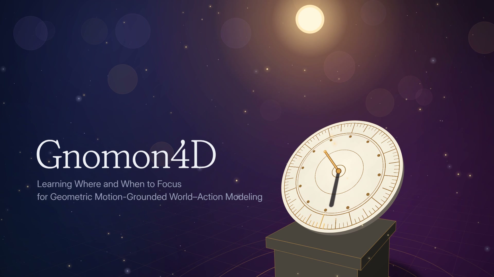

# Gnomon4D

**Learning Where and When to Focus for Geometric Motion-Grounded World-Action Modeling**



Gnomon4D jointly predicts future video, explicit 4D motion (GeoDelta), and robot actions. Interaction-Salient Attention (InSAttn) and Transition-Anchored Aggregation (TransAgg) use the predicted motion to determine where and when the action expert should focus.

This repository contains the project website, including the video overview, interactive method visualizations, experimental results, and rollout gallery.

## Repository structure

```text
Gnomon4D/
├── index.html                 # Website entry point and page content
├── README.md
├── .gitignore
└── assets/
    ├── app.js                 # Players, charts, tabs, and gallery interactions
    ├── data.js                # Demo metadata, chapter timestamps, and chart data
    ├── sundial.js             # Interactive sundial
    ├── style.css              # Layout and styling
    ├── Gnomon4D_supp.vtt       # English video subtitles
    ├── media/                 # Main video, demo clips, and preview images
    ├── fig/                   # Research figures
    ├── probe/                 # Attention visualization frames
    ├── fonts/                 # Website fonts
    ├── katex/                 # Local equation renderer and its fonts
    └── icon/                  # Website icons
```

## Local preview

From the repository root, run:

```bash
python3 -m http.server 8000 --bind 127.0.0.1
```

Open [http://127.0.0.1:8000](http://127.0.0.1:8000). Press `Ctrl+C` to stop the server.

The site uses plain HTML, CSS, and JavaScript. No dependency installation or build step is required. Videos start when the reader presses play; the method diagram's three video streams run together when Observation is played.

## GitHub Pages deployment

Publish this directory as the repository root, with `index.html` and the complete `assets/` directory alongside this README. All runtime resources are bundled locally and use relative paths, so the site can be served from a project subdirectory.

After pushing the repository to GitHub:

1. Open **Settings → Pages**.
2. Under **Build and deployment**, select **Deploy from a branch**.
3. Select the branch containing the website, such as `main`, and the **/(root)** folder.
4. Click **Save** and wait for the deployment to complete.

See the [official GitHub Pages publishing guide](https://docs.github.com/en/pages/getting-started-with-github-pages/configuring-a-publishing-source-for-your-github-pages-site).

### Media size and loading

The main overview, `assets/media/Gnomon4D_supp.mp4`, is approximately **67.3 MiB** and **6 minutes 12.5 seconds** long. It retains 1920 × 1080 resolution at 30 fps and both audio tracks. Additional rollout examples are available in the Gallery.

Videos load when played. The main MP4 places its metadata at the beginning for progressive playback. Website fonts use local WOFF2 files, and attention frames are fetched by scene when the corresponding visualization enters view. JPEG previews use lossless optimization.

When replacing media, keep individual files below GitHub's **100 MiB** limit for regular Git. See [GitHub's file size limits](https://docs.github.com/en/repositories/working-with-files/managing-large-files/about-large-files-on-github).

Keep the videos, images, fonts, subtitles, CSS, and JavaScript in the repository. The `.gitignore` excludes local system files, editor settings, temporary files, logs, caches, and development dependencies.

## Updating the website

- Edit page text and tables in `index.html`.
- Edit demo metadata and chapter timestamps in `assets/data.js`.
- Edit playback and interaction behavior in `assets/app.js`.
- Edit styling in `assets/style.css` and the sundial in `assets/sundial.js`.
- Replace videos and preview images inside `assets/media/`, keeping their paths consistent with the HTML and demo metadata.
- When the main video changes, update its poster, chapter timestamps, and subtitles to match.

Preview changes locally before publishing, including video playback, subtitles, case selection, and the mobile layout.
